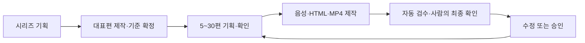

# Instagram 쇼츠 제작 프레임워크

**시리즈의 제작 기준을 정하고, HTML 애니메이션 쇼츠를 5~30편씩 기획·제작·검수하는 로컬 프레임워크입니다.**

Codex와 주제·대본·화면 구성을 구체화하고, Node.js 실행기가 한국어 음성 합성부터 애니메이션 타이밍 계산, MP4 출력, 검수와 재개를 담당합니다. 대표 영상을 함께 조정해 시리즈의 특색을 정한 뒤 같은 제작 규칙으로 다음 회차를 이어갑니다.

현재는 **Windows 기반 MVP**입니다. 완성 영상은 사람이 확인·승인하며, Instagram 실제 업로드·예약 게시 기능은 포함하지 않습니다. 저장소의 CS·퍼센트 영상 명세는 프레임워크 검증용 예제입니다.

- [전체 제작 흐름](#전체-제작-흐름)
- [준비할 도구](#준비할-도구)
- [빠른 시작](#빠른-시작)
- [Codex와 실제 시리즈 시작하기](#codex와-실제-시리즈-시작하기)
- [결과 확인·수정·재개](#결과-확인수정재개)
- [저장 구조와 PC 이동](#저장-구조와-pc-이동)
- [테스트와 상세 문서](#테스트와-상세-문서)

## 전체 제작 흐름



| 단위 | 역할 |
| --- | --- |
| 시리즈 | 주제·대상·말투·디자인·음성·제작 방식·검수 기준을 유지합니다. |
| 기간 계획 | 날짜·요일·하루 게시 예정 시각으로 회차를 배정합니다. |
| 제작 묶음 | 여러 회차를 함께 기획하고 진행 상태를 관리합니다. |
| 회차 | 대본·장면·음성·영상·검수·승인 이력을 독립적으로 가집니다. |

자동 기획은 기존 회차 이력과 중복을 검사합니다. 내용 검증을 필수로 설정하면 등록한 자료와 대본·화면 문구를 대조합니다. TTS에서 얻은 실제 발화 시각으로 장면 전환·강조·카드 이동을 구성하고, 화면 검사 후 MP4를 출력합니다. 입력과 산출물이 유효하면 완료 단계를 재사용합니다.

| 기능 | 현재 지원 범위 |
| --- | --- |
| 기획 | 준비된 대본 등록 또는 모델을 통한 기획·대본·장면 생성, 내용 중복 검사 |
| 공통 화면 | 질문·설명·카드·결론, 카드 강조·장면 사이 이동, 시리즈별 색상·전환 설정 |
| 음성·영상 | Windows 한국어 System.Speech, 음성 큐 기반 타임라인, 1080×1920·30fps MP4 |
| 검수 | 등록 근거 대조, 잘림·화면 이탈·가독성 검사, 영상·오디오 규격 검사 |
| 수정·재개 | 제한된 제목·화면 문구 자동 보완, 요청한 문구·낭독 수정, 실패 회차 재개 |
| 운영 | 기간·묶음 실행, 회차별 상태, 최종 승인 이력, 인수인계 문서·파일 무결성 검사 |
| 후속 확장 | BGM·효과음 공통 설정, 다양한 비율·TTS 제공자, 자유로운 장면 생성, Instagram 게시·예약 실행 |

검수 통과는 사람의 승인과 구분됩니다. 내용 검증은 **등록된 근거 자료와의 일치 확인**이며 자료의 자동 검색·최신성 확인을 수행하지 않습니다. 새로운 시각 표현은 컴포넌트나 어댑터 확장이 필요할 수 있습니다.

## 준비할 도구

아래 명령은 저장소 루트의 **Windows PowerShell**에서 실행합니다. 실제 제작은 Node.js 24와 HyperFrames 0.9.17을 사용해 검증했습니다.

| 도구 | 필요한 작업 | 준비·확인 방법 |
| --- | --- | --- |
| Git | 저장소 받기·버전 관리 | `git --version` |
| Node.js 24 | CLI·로컬 테스트 | [공식 다운로드](https://nodejs.org/en/download)에서 24 계열 설치 후 `node --version` |
| Windows PowerShell / 한국어 System.Speech | 음성 조회·TTS | 예제는 `Microsoft Heami Desktop` 사용. `series check`로 실제 설치 여부 확인 |
| FFmpeg·ffprobe | 음성 처리·영상 규격 검사 | 설치 후 PATH에 추가하거나 아래 환경 변수 지정. `ffmpeg -version`, `ffprobe -version` |
| HyperFrames 0.9.17 | HTML → MP4 | [HyperFrames 프로젝트](https://github.com/heygen-com/hyperframes). 아래 설치 예시 참고 |
| Chrome / puppeteer-core | 렌더링·화면 검사 | Chrome 설치. puppeteer-core는 HyperFrames의 설치 의존성에서 탐색 |
| 맑은 고딕 등 설정한 글꼴 | 한글 화면 | 예제는 Windows의 `Malgun Gothic` 사용 |
| Codex CLI와 로그인 | 자동 기획·의미 중복·내용 검사·모델 수정 | 모델 기능을 사용할 때 필요. 준비된 입문 예제는 추가 모델 호출 없이 등록·제작 가능 |

공통 실행기와 기본 테스트는 Node.js 내장 모듈을 사용합니다. **루트에는 `package.json`이 없으므로 `npm install`이나 `npm test`를 공통 설치·테스트 명령으로 사용하지 않습니다.** `samples/speech-sync/package.json`은 이전 Azure 음성 실험용입니다. Python도 해당 실험 검증용이며 공통 제작 경로의 필수 도구는 아닙니다.

HyperFrames가 없다면 다음과 같이 설치할 수 있습니다. 패키지를 내려받는 환경 준비 명령이며 영상 제작은 하지 않습니다.

```powershell
npm install --global hyperframes@0.9.17
hyperframes --version
```

도구를 자동으로 찾지 못할 때만 다음 환경 변수를 실제 설치 경로로 지정합니다. 도구·puppeteer-core를 실행 중 자동 설치하지 않습니다.

| 환경 변수 | 지정할 값 |
| --- | --- |
| `HYPERFRAMES_CLI` | HyperFrames의 `bin/hyperframes.mjs` 또는 실행 파일. `.cmd`·`.bat`·`.ps1` 래퍼는 지원하지 않음 |
| `HYPERFRAMES_FFMPEG_PATH` | `ffmpeg.exe` 절대 경로 |
| `HYPERFRAMES_FFPROBE_PATH` | `ffprobe.exe` 절대 경로 |
| `HYPERFRAMES_BROWSER_PATH` | Chrome 실행 파일 절대 경로 |
| `VISUAL_PUPPETEER_PATH` | 설치된 `puppeteer-core` 패키지 폴더 또는 모듈 진입 파일의 절대 경로 |

예제 음성이 없으면 Windows의 한국어 음성 구성 요소를 준비한 뒤 다시 점검합니다. 다른 설치된 한국어 음성을 사용하려면 해당 시리즈의 음성 설정도 맞춰야 합니다. 등록 점검 통과만으로 FFmpeg·Chrome·렌더링 전체가 검증되는 것은 아닙니다.

## 빠른 시작

### 1. 저장소 확인 — 제작 없이 조회

```powershell
git clone https://github.com/skybluejaecho/instagram_shorts_maker.git
cd instagram_shorts_maker
node --version
node pipeline/cli.cjs --help
node pipeline/cli.cjs series list
```

도움말에 실행 명령이 출력되면 CLI가 준비된 상태입니다. 새 복제본의 등록 시리즈 목록이 비어 있는 것은 정상입니다. 기존 운영 작업을 이어가려면 먼저 [PC 이동 절차](#pc를-바꿀-때)를 따릅니다.

### 2. 준비된 CS 예제 등록 — 로컬 상태 저장

첫 예제로 스택과 큐를 설명하는 30초 회차 두 편을 사용합니다.

```powershell
node pipeline/cli.cjs series check samples/story/series.json
node pipeline/cli.cjs series register samples/story/series.json
node pipeline/cli.cjs plan add story-demo samples/story/plans.json
node pipeline/cli.cjs plan batch story-demo story-demo-pair --plans "stack,queue"
node pipeline/cli.cjs batch status story-demo-pair
```

`series check`는 설정·설치 음성을 조회하며 합성하지 않습니다. 오류가 있으면 해결한 뒤 등록합니다. 나머지 명령은 카탈로그와 회차 입력·묶음을 저장하고, 두 회차는 아직 제작되지 않은 상태로 표시됩니다. 이 단계는 TTS·렌더링·추가 모델 호출을 실행하지 않습니다.

입문 예제는 내용 검증 정책이 미설정이므로 관련 경고가 나올 수 있습니다. 이를 사실 검증을 통과했다는 뜻으로 해석하지 않습니다. 실제 지식 시리즈에는 [근거 자료와 내용 검증](pipeline/content/README.md)을 설정합니다. 이미 운영 중인 저장소에서는 기존 ID와 설정을 먼저 확인합니다.

### 3. 실제 영상 제작 — TTS·브라우저·MP4 실행

앞의 도구 준비와 등록을 마친 후 실행합니다.

```powershell
node pipeline/cli.cjs batch run story-demo-pair
node pipeline/cli.cjs review list story-demo-pair
```

현재 입문 예제는 준비된 대본과 검증 비활성 정책을 사용하므로 자동 기획·근거 검증 모델을 호출하지 않습니다. **실제 한국어 TTS·화면 검사·MP4 제작은 실행합니다.** 다른 시리즈의 필수 내용 검증 정책이나 자동 수정 경로에서는 모델이 호출될 수 있습니다.

완료되면 `ready_for_review`와 MP4·검수 보고서 경로가 표시됩니다. 영상과 보고서를 확인하고 승인하거나 수정 요청을 기록합니다. 파일은 `runs/<회차 ID>/` 아래에 저장됩니다.

### 4. 5일치 계획 확인 — 준비된 회차 연결

```powershell
node pipeline/cli.cjs series register samples/period/series.json
node pipeline/cli.cjs plan add period-cs-demo samples/period/plans.json
node pipeline/cli.cjs period create samples/period/five-days.json
node pipeline/cli.cjs period status cs-five-days
```

준비된 대본 다섯 편과 게시 예정 슬롯을 연결합니다. 예시 시작일은 **2026-11-16**, 하루 한 편, 기획 묶음 크기는 2입니다. 이 명령들은 영상을 제작하거나 Instagram에 게시하지 않습니다. 실제 운영에서는 새 기간 ID와 원하는 날짜로 별도 명세를 준비합니다.

제작을 시작할 때는 `node pipeline/cli.cjs period run cs-five-days`를 사용합니다. 이후 30편 등의 계획은 작은 묶음으로 나누어 처리합니다. 상세 설정은 [기간 제작 안내](pipeline/period/README.md)에 있습니다.

## Codex와 실제 시리즈 시작하기

저장소를 작업 폴더로 열고 새 채팅에서 다음처럼 시작할 수 있습니다.

> 이 저장소의 AGENTS.md, 에이전트 작업 흐름, 제공된 운영 메모를 읽어줘. 새 시리즈의 주제는 ○○, 시청자는 ○○이고 참고 자료는 ○○에 있어. 우선 시리즈 기획서와 대표 회차 1편의 구성을 정리하고, 현재 렌더러로 가능한 부분과 추가 구현이 필요한 부분을 구분해줘. 아직 추가 모델 호출·TTS·영상 제작은 진행하지 마.

1. [시리즈 기획 양식](planning/examples/series-brief.md)으로 방향과 자료를 정합니다.
2. 대표편의 대본·화면·음성 큐를 구성하고 제작·수정하여 시리즈 기준을 확정합니다.
3. 첫 5편을 운영해 반복 제작이 가능한지 확인한 뒤 5~30편씩 확대합니다.
4. 합의와 변경 이유는 `local/series/<시리즈 ID>/BRIEF.md`, `DECISIONS.md`에 남깁니다. 파일 경로는 운영 관례이며 자동 생성·탐색 기능이 아닙니다.

대화하는 Codex가 기획 결정을 실제 설정·명세·템플릿에 연결합니다. 프레임워크 내부 모델은 전달된 설정·이력·등록 근거를 사용하며, 임의 Markdown이나 이전 채팅 전체를 자동으로 읽지 않습니다. 근거는 저장소 내부 `.md`/`.txt`로 준비해 `contentReview.sources`에 등록합니다.

자동 기획을 포함한 명령은 모델 이용량을 사용합니다. **자동 생성 모드의 `--plan-only`도 모델과 실제 TTS 검증을 실행**하고 MP4 출력 전에 멈춥니다. 기획 대화만 하는 옵션이나 비용 없는 dry-run으로 취급하지 않습니다. 요청 범위와 기존 운영 조건을 확인하고 실행합니다.

새 채팅에서는 [AGENTS.md](AGENTS.md) → [에이전트 작업 흐름](pipeline/agent-workflow.md) → 제공된 `local/PROJECT_NOTES.md`와 시리즈 문서 순으로 맥락을 확인합니다. Git 복제본에는 개인 운영 메모가 없을 수 있습니다.

## 결과 확인·수정·재개

| 하고 싶은 일 | 명령 또는 처리 |
| --- | --- |
| 회차·묶음·기간 진행 확인 | `status <회차-ID>`, `batch status <묶음-ID>`, `period status <기간-ID>` |
| 현재 영상·검토 버전 확인 | `review list <묶음-ID>` |
| 사람이 확인한 영상 승인 | `review approve <회차-ID> --revision <현재-Revision>` |
| 수정 요청 기록 | `review request-changes <회차-ID> --revision <현재-Revision> --target <장면-ID> --note "수정 내용"` |
| 화면 문구 수정 적용 | `review apply <회차-ID> --request <요청-ID> --scope visual` — 모델·검수·재제작 가능 |
| 실패·보류 회차 다시 시도 | `batch retry-failed <묶음-ID>` 또는 `period retry-failed <기간-ID>` |
| 미시작·중단·변경 회차까지 이어가기 | `period resume <기간-ID>` |

각 명령 앞에 `node pipeline/cli.cjs`를 붙입니다. 조회 명령은 모델을 호출하지 않습니다. 수정·재개는 기존 ID를 유지하고, 새 기간을 만들 때 새 ID를 사용합니다.

화면 문구만 바뀌면 음성을 재사용하고 필요한 화면·영상 단계부터 다시 실행합니다. 낭독문·음성 설정이 바뀌면 음성과 타이밍을 다시 만듭니다. 완료 산출물이 유효하면 재실행 시 그대로 사용합니다. 근거 부족은 자료를 보완해야 하며, 같은 조건으로 반복 실행해 자동 보완 한도를 초기화하지 않습니다.

근거 자료나 내용·화면 검수 기준이 바뀌면 다시 검수합니다. 영상 파일이 같더라도 활성 검수의 키·보고서가 달라지면 새 Revision으로 확인·승인해야 합니다. 렌더링·기술 검수 코드가 바뀐 경우에는 준비된 음성·HTML을 재사용하면서 MP4와 기술 검수 결과를 갱신합니다.

현재 자동 수정은 지원되는 제목·본문·낭독 범위에 한정됩니다. 배치·애니메이션 구조를 바꾸려면 회차 명세나 템플릿을 수정해야 합니다. 새 영상은 다시 최종 검토 대상으로 남습니다. 자세한 범위는 [수정 요청 안내](pipeline/revision/README.md)를 참고합니다.

## 저장 구조와 PC 이동

```text
AGENTS.md                     에이전트 시작 지침
pipeline/                     실행기·제작 단계·검수·테스트·상세 문서
planning/examples/            공유할 설정·기획 예제
samples/                      템플릿·대본·근거·고정 검증 자료
planning/catalog.json         실제 등록·기획·일정 데이터 [로컬]
planning/inputs/              생성된 회차 입력 [로컬]
runs/                         실행·검수·승인 기록과 음성·영상 [로컬]
renders/                      이전 프로토타입 출력 [로컬]
local/                        개인 시리즈 문서·자료·인수인계 [로컬]
```

코드·템플릿·고정 예제는 Git에 저장합니다. 카탈로그·회차 입력·실행 기록·영상은 `.gitignore`로 제외합니다. `samples/` 안의 생성 폴더와 도구 캐시도 제외하지만, 검증용으로 고정한 근거 노트·보고서는 포함합니다. 인증 파일은 따로 관리합니다.

입력·산출물·고정 자료의 검증은 파일 바이트 해시를 사용합니다. `.gitattributes`는 Git의 자동 줄바꿈 변환을 비활성화해 커밋·복제 시 바이트를 보존합니다. 의도적인 줄바꿈 변경은 관련 해시·검증·재사용 영향과 함께 검토합니다.

### PC를 바꿀 때

기존 PC에서 작업과 편집을 끝낸 뒤 새 인수인계 ID로 기록을 만듭니다.

```powershell
node pipeline/cli.cjs handoff export move-001
```

`local/handoffs/move-001/`에 요약 Markdown과 파일 경로·SHA-256 목록이 생성됩니다. **이 명령은 실제 복사·압축·업로드를 하지 않습니다.** 목록에 있는 코드·자료·운영 데이터·산출물과 인수인계 폴더를 Drive나 별도 디스크로 함께 옮깁니다.

새 PC에서 상대경로 구조를 유지해 복원한 뒤 확인합니다.

```powershell
node pipeline/cli.cjs handoff check move-001
```

파일이 일치하면 도구·음성·글꼴을 준비하고 현재 상태를 조회한 뒤 재개합니다. Git clone만으로 기존 운영 상태는 복원되지 않습니다. 두 PC에서 같은 운영 데이터를 동시에 실행하지 않으며, 과거 보고서의 절대경로를 일괄 치환하지 않습니다. 자세한 내용은 [PC 이동·인수인계 안내](pipeline/handoff/README.md)에 있습니다.

## 테스트와 상세 문서

기본 로컬 테스트는 모델·미디어 도구를 모의하여 실행 흐름, 검수 조건, 재사용·복구를 확인합니다.

```powershell
$pipelineTestFiles = (Get-ChildItem -LiteralPath pipeline -Recurse -Filter '*.test.cjs').FullName
node --test @pipelineTestFiles
```

실제 Chrome 검사는 `VISUAL_BROWSER_TEST=1`일 때 선택적으로 실행되므로 기본 실행에서 건너뛰는 항목이 있을 수 있습니다. `validate-*.cjs`는 별도 통합 검증 도구이며 일부는 실제 모델·TTS·영상 제작과 운영 상태를 사용합니다. 기본 테스트 대신 일괄 실행하지 말고 해당 안내의 준비 사항과 실행 범위를 확인합니다.

기존 CS 예제로 실제 제작·재개를 검증했지만, 모든 기능을 실제 모델로 재검증했다는 뜻은 아닙니다. 최대 두 번의 제작 문구 보완은 구현·로컬 테스트까지 완료됐으며 해당 경로의 실제 모델·새 MP4 통합 검증은 실행하지 않았습니다. 새 PC에서 도구를 처음 설치하는 검증과 파일 복원 검증도 구분합니다.

| 문서 | 내용 |
| --- | --- |
| [전체 실행기](pipeline/README.md) | 명령·상태·저장 정책 |
| [에이전트 작업 흐름](pipeline/agent-workflow.md) | Codex가 읽을 순서와 명령의 영향 |
| [공통 회차 명세](pipeline/story/README.md) | 대본·장면·음성 큐·디자인 설정 |
| [자동 기획](pipeline/generation/README.md) | 모델 입력·생성·검증·재개 |
| [내용 검증](pipeline/content/README.md) / [문구 보완](pipeline/content/repair-README.md) | 등록 근거와 자동 수정 한도 |
| [의미 중복 검사](pipeline/novelty/README.md) / [화면 검수](pipeline/visual/README.md) | 회차 중복·화면 가독성 기준 |
| [기간 제작](pipeline/period/README.md) / [수정 요청](pipeline/revision/README.md) | 반복 제작·부분 수정·재개 |
| [인수인계](pipeline/handoff/README.md) | PC 이동·파일 검증·기록 보존 |
